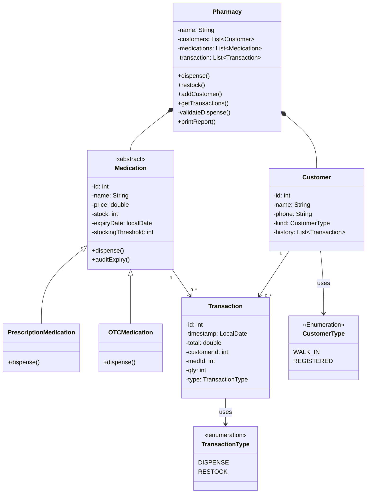

# Akosua's Pharmacy — Stock and Dispensing Tracker


A small in-house program that Akosua's pharmacy uses to track what is in stock
and what gets dispensed. It works, but it has become risky to change. Your task
is to diagnose it and rebuild it well — **not** to change what it does, but to
make it safe to change and impossible to leave in an invalid state.

## Running it

The program is plain Java (no external dependencies). You need JDK 21.

**With Maven:**

```bash
mvn compile
mvn exec:java -Dexec.mainClass=PharmacyTracker
```

**Or directly with the JDK:**

```bash
javac -d target/classes src/main/java/PharmacyTracker.java
java -cp target/classes PharmacyTracker
```


# Rebuild
The class diagram of the proposed rebuild of the PharmacyTracker program.

## Class Diagram


