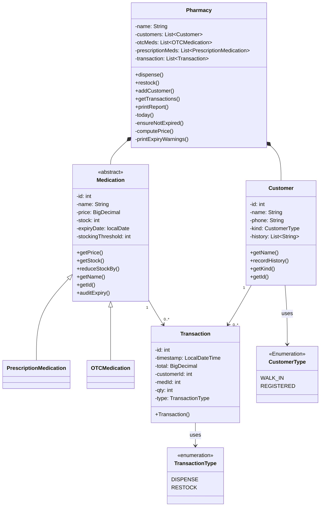

# Akosua's Pharmacy — Stock and Dispensing Tracker


A small in-house program that Akosua's pharmacy uses to track what is in stock
and what gets dispensed. It works, but it has become risky to change. Your task
is to diagnose it and rebuild it well — **not** to change what it does, but to
make it safe to change and impossible to leave in an invalid state.

## Running it

The program is plain Java (no external dependencies). You need JDK 21.

**With Maven:**

```bash
mvn compile
mvn exec:java -Dexec.mainClass=PharmacyTracker
```


## Most dangerous defect from the diagnosis

**Dispensing more than is in stock.** The original program "dispensed" 100 Amoxicillin when only 40 existed, charged GHS 3000 and left stock at -61. For a pharmacy this is the worst defect: a patient can leave with an incomplete antibiotic course while the record says it was full, and prescription-only stock that doesn't reconcile can cost the pharmacy its licence at inspection.


## Rebuild
The class diagram of the proposed rebuild of the PharmacyTracker program.

## Class Diagram


## Design reasoning

**Key decisions, and what I chose them over**

- **Subclasses instead of a `category` string.** `OTCMedication` and `PrescriptionMedication` extend an abstract `Medication`, rather than one class holding `"OTC"`/`"PRESCRIPTION"`. A typo such as `"Otc"` can no longer silently skip every rule, and the compiler picks the right `dispense` for each type.
- **Enums instead of free-text strings.** `CustomerType` and `TransactionType` limit the values to ones the program actually handles, so a fake category can't get in.
- **Private fields with guarded methods instead of public fields.** Stock only changes through `reduceStockBy`/`increaseStockBy`, which reject negative amounts and over-dispensing. Objects are validated in their constructors, so none can exist in an invalid state, and stock can no longer reach -61.
- **`BigDecimal` instead of `double` for money,** so totals like 12.50 × 0.95 don't pick up rounding errors.
- **`Transaction` as an immutable `record`, and `getTransactions()` returning a copy,** instead of handing out the live list for callers to edit.

**How the coming change fits in**

- To add a new kind of medication (e.g. controlled drugs), you write one new `Medication` subclass. It inherits all the validation, expiry and stock rules unchanged. `Pharmacy` then gets a matching `dispense` overload that holds only the rule specific to the new kind.
- The existing medication classes, `Customer`, `Transaction`, and the OTC and prescription dispensing code are not touched, so what already works keeps working. The unit tests confirm that.

**What the old version would have forced you to touch**

- `dispense()` was one `if (m.category.equals("OTC")) … else if (…"PRESCRIPTION")` block, so the new kind meant another branch in the middle of working code. That branch had to copy the price calculation, the hardcoded `0.95` discount and the unguarded `m.stock = m.stock - qty` again.
- Nothing stopped code elsewhere from writing to the public `stock`/`price` fields directly. And a misspelled category string would have fallen through every branch while still recording a dispense transaction.


## One improvement beyond the brief

**Expiry checks.** Medicine was only checked for expiry when it was first registered, so a box that expired on the shelf could still be dispensed.

- **What it does:**
  - `dispense` refuses expired stock with an `ExpiredMedicationException`, before any stock is touched.
  - The end-of-day report lists anything expired ("remove from shelf") or expiring within 30 days.
- **Why it matters to the business:** giving a patient expired medicine is a patient-safety and regulatory failure, the same kind of risk as the most dangerous defect above. The 30-day warning lets Akosua sell the stock or return it to the supplier before it becomes a write-off.
- **Why it helps the next developer:**
  - The expiry rules live on `Medication` (`isExpiredOn`, `expiresWithin`), so any new medication type inherits them.
  - `Pharmacy` takes a `Clock`, so tests can pin "today" to a fixed date.
  - 19 unit tests cover the feature, including the expiry day itself and the 30-day boundary.

## Code run output
### Before 
```text
Dispensed 2 x Paracetamol 500mg to Kofi Mensah for GHS 25.0
Dispensed 1 x Amoxicillin 250mg to Ama Owusu (prescribed by Dr. Boateng) for GHS 28.5
Restocked 50 x Paracetamol 500mg
Dispensed 100 x Amoxicillin 250mg to Kofi Mensah (prescribed by Dr. Boateng) for GHS 3000.0

=== Akosua's Pharmacy - end of day ===
Stock levels:
  Paracetamol 500mg (OTC): 148 in stock
  Amoxicillin 250mg (PRESCRIPTION): -61 in stock
Transactions today: 4
```


### After
```text
Dispensed 2 x Paracetamol 500mg to Kofi Mensah for GHS 25.00
Dispensed 1 x Amoxicillin 250mg to Ama Owusu (prescribed by Dr. Boateng) for GHS 28.50
Restocked 50 x Paracetamol 500mg
Could not complete: Insufficient stock for Amoxicillin 250mg: requested 100, available 39

=== Akosua's Pharmacy - end of day ===
Stock levels:
  Paracetamol 500mg (OTC): 148 in stock
  Amoxicillin 250mg (PRESCRIPTION): 39 in stock
Transactions today: 3
```